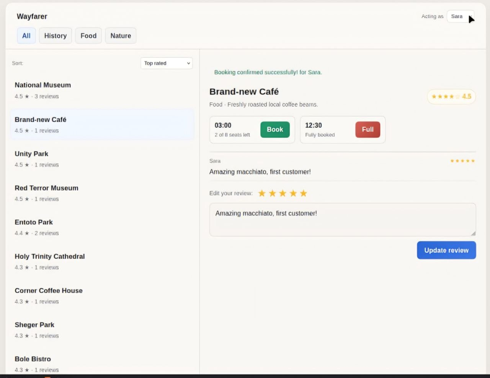

# Wayfarer Backend App

Full-stack application containing data-safe tour booking and honest algorithmic place rankings.

### Setup Instructions
1. Run `npm install` to load all packages.
2. Run `npx prisma migrate dev --name init` to generate the SQLite file.
3. Run `npx ts-node prisma/seed.ts` to populate user records.

> To see the database table run `npx prisma studio`
> To run the tests use `npm run test:wayfarer`

### Launch Server
Run `npm run start:dev` to turn on the local NestJS server.

## Screenshot

